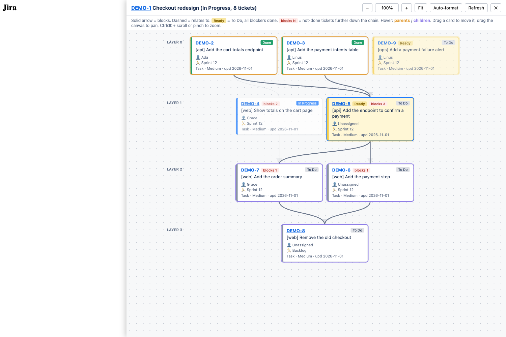

# jira-epic-graph

A Chrome extension that shows the tickets of a Jira epic as a dependency graph.

- No admin install. Any user can load it.
- No data leaves the browser. It reads Jira's own REST API with your session.
- Shows which tickets are ready to pick up.



## What it shows

```
Layer 0   [done]   [done]   [ready]
              \      /
Layer 1      [ready]  ── blocks ──▶
              /    \
Layer 2   [to do]  [to do]
```

- One card per child ticket of the epic: status, assignee, sprint, type, priority, last update.
- Rows are topological layers. A card depends only on cards above it.
- Solid arrow = blocks. Dashed arrow = relates to.
- Yellow card = **Ready**: the ticket is To Do and all its blockers are Done.
- **blocks N** = the number of not-done tickets further down its chain. Use it to pick which Ready ticket to start first.
- Hover a card: its parents (orange) and children (purple) light up, through the full chain.

## Install

1. Download or clone this repo.
2. Open `chrome://extensions` and turn on **Developer mode**.
3. Click **Load unpacked** and select the `extension/` folder.
4. Pin **Jira Epic Graph** to the toolbar.

## Use

1. Open an epic in Jira Cloud (`*.atlassian.net`).
2. Click the extension icon. Click again, or press Esc, to close.

| Action | How |
|---|---|
| Move a card | Drag the card |
| Pan | Drag the empty canvas, or scroll |
| Zoom | Ctrl/⌘ + scroll, pinch, or the − / + buttons |
| Show the whole epic | **Fit** |
| Reset the layout | **Auto-format** |
| Load fresh data | **Refresh** |

## Privacy

- The extension does nothing until you click the icon.
- It makes 3 kinds of requests, all to the Jira site you are on: the epic, the field list (to find the Sprint field), and the epic's child tickets.
- No analytics, no external scripts, no API token.
- Permissions: `scripting` (inject the panel on click) and `https://*.atlassian.net/*`.

## Limits

- Links to tickets outside the epic are not shown.
- Only "blocks" links count as dependencies for layers, Ready and the hover chain.
- Card positions are not saved.

## Test

The smoke test loads the extension in Chromium against a fake Jira site with made-up tickets.

```sh
npm install
npx playwright install chromium
npm test                  # SCREENSHOT=1 npm test also updates docs/screenshot.png
```

## License

MIT
